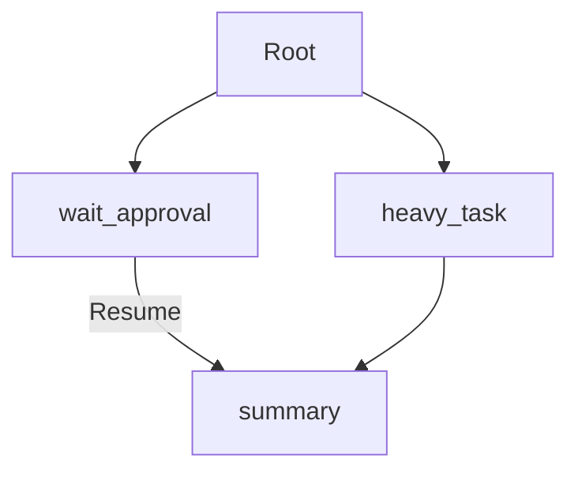

# workflow

A flexible, durable, and interruptible DAG workflow engine in Go.

## example



```go
package main

import (
    "context"
    "log/slog"
    "time"

    "github.com/azusayn/workflow"
)

type WaitApprovalNode struct{}

func (WaitApprovalNode) Execute(ctx context.Context) error {
    return workflow.WaitFor(ctx, workflow.Condition{EventID: "approval_event"})
}

type HeavyTaskNode struct{}

func (HeavyTaskNode) Execute(ctx context.Context) error {
    time.Sleep(1 * time.Second)
    return workflow.Set(ctx, "heavy_task", "score", 95)
}

type SummaryNode struct{}

func (SummaryNode) Execute(ctx context.Context) error {
    score, err := workflow.Get[int](ctx, "score")
    if err != nil {
        return err
    }
    slog.Info("Workflow completed successfully", "score", score)
    return nil
}

func main() {
    ctx := context.Background()

    workflow.Register("wait_approval", WaitApprovalNode{})
    workflow.Register("heavy_task", HeavyTaskNode{})
    workflow.Register("summary", SummaryNode{})

    configs := map[string]*workflow.NodeConfig{
        workflow.RootNodeID: {
            NextNodeIDs: []string{"wait_approval", "heavy_task"},
        },
        "wait_approval": {
            NextNodeIDs: []string{"summary"},
        },
        "heavy_task": {
            NextNodeIDs: []string{"summary"},
        },
        "summary": {
            Inputs: workflow.NodeInputConfig{
                "score": "heavy_task",
            },
        },
    }

    engine := workflow.NewEngine(workflow.WithNodeExecutorNum(2))
    w, _ := engine.CreateWorkflow(ctx, "demo-pipeline", configs)

    go engine.StartNodeExecutors(ctx)
    go engine.StartEventProcessor(ctx)

    _ = engine.RegisterCallback("approval_event", func(ctx context.Context, _ any) error {
        return workflow.Resume(ctx)
    })

    runID, _ := w.Run(ctx, nil)

    time.Sleep(200 * time.Millisecond)
    _ = engine.Post(ctx, &workflow.WorkflowEvent{
        ID:            "approval_event",
        WorkflowRunID: runID,
        NodeID:        "wait_approval",
    })

    select {}
}
```
